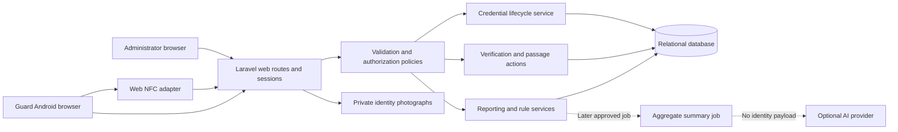

# NFCheck architecture proposal

Status: **Phases 1–5 implemented locally**, including assigned-guard verification, identity review, confirmed passage and recent activity. Broader reporting/correction/anomaly design remains future work. See [the Phase 5 report](phase-5-report.md). Physical NFC is untested; Phase 6 awaits approval. User-selected development defaults are 30-second review validity and a 10-second duplicate window.

## Purpose and boundaries

NFCheck supports campus gate identity review and entry/exit monitoring for Bicol University Polangui. It covers students, employees, security guards and administrators. Enrollment may inform an authorization record; enrollment verification is no longer the application's main purpose. Gate activity is not official classroom attendance.

The core scope is authentication, identity management, gates and guard assignments, credential lifecycle, scanning, guard-confirmed passage, history, monitoring and reports. Explainable anomaly detection is a planned later module. AI summaries are conditional on approved scope, provider/privacy review and budget. Supervisor roles, imports, machine learning, automatic barriers and classroom attendance are outside the initial implementation.

## Application structure

Use one Laravel application, React and TypeScript through Inertia, Tailwind styling, Vite assets, and a supported relational database. Keep the framework's official directory conventions at the existing project root. Select exact versions through the environment audit and dependency resolution after Phase 1 approval.

Laravel owns authorization, validation, access decisions, database transactions, audit records and report aggregates. React owns presentation, user interaction, browser NFC integration and feedback. Browser roles, supplied timestamps, selected gates and NFC content are untrusted inputs.

Organize focused controllers and form requests under `app/Http`; policies under `app/Policies`; transactional use cases under `app/Actions`; credential, reporting and rule logic under appropriately named services. React uses reusable components, layouts, hooks, typed server props and pages under `resources/js`. Create folders only when code needs them. Do not add a separate Node backend or Python service.

Use authenticated same-origin sessions, CSRF protection and Laravel's password recovery flow. Public registration is disabled. Add jobs for slow exports and optional summaries when needed; the scan decision remains synchronous. Introduce polling for recent activity before adopting a separate real-time infrastructure.

## Identity and operator permissions

Campus identity records are separate from operator accounts. Being a student or employee does not automatically grant application login. Initially use only `admin` and `guard` roles, with server-side policies on every route and object.

| Capability | Administrator | Guard |
|---|---|---|
| Accounts, people, gates, assignments and credential lifecycle | Authorized administration | Denied |
| Scan and confirm passage | Admin role alone does not permit scanning | Active assigned gates only |
| View verification photograph and identity | Authorized purpose | Minimum data for permitted verification |
| Global history, exports and analytics | Authorized and audited | Denied |
| Recent station activity | Authorized | Assigned station and approved time window |
| Report suspicious activity | Authorized | Assigned station |
| Resolve anomalies; manage settings and audit access | Authorized | Denied |
| Correct history | Append-only correction with reason | Denied |

Check active accounts, active gates and effective assignment intervals at scan and confirmation time. A disabled person overrides an otherwise valid authorization. Initially use campus-wide grants with explicit validity periods; gate-specific member authorizations require a separate approved requirement.

## Verification and recorded passage

1. The active guard chooses an assigned active gate and explicit Entry or Exit mode.
2. A user gesture starts NFC reading. The client accepts only the constrained, versioned NDEF credential format and submits the credential plus a generated request identifier.
3. Laravel validates the request, guard, gate, assignment, credential, person and effective access authorization. It stores a `scan_attempts` outcome using server time.
4. An allowed attempt returns minimum identity information and a photograph for guard review. The initial proposed review validity is **30 seconds**, configurable and subject to gate usability testing.
5. The guard confirms observed passage, rejects identity match, cancels, or reports an incident. The interface must distinguish “credential authorized,” “identity reviewed,” and “passage recorded.”
6. Confirmation belongs to the same guard, gate and direction. Laravel rechecks current authorization, account, assignment, person and credential status before writing one immutable `access_events` record.
7. Only confirmed passage changes the recorded presence projection. Denied, cancelled, expired and unconfirmed scans never count as passage.

A credential read does not establish rightful ownership or physical crossing. Guard confirmation is an observation recorded by an operator. NTAG215 credentials can be copied; the design does not claim universal cloning prevention. No NFC hardware UID is used as secure identity proof.

The application fails closed for authorization when verification cannot complete. It does not control emergency exits or physical barriers. Campus emergency procedures remain independent of application availability and inferred presence.

## Retry, concurrency and history rules

Use a unique `(guard_id, request_id)` for scan attempts. Persist a canonical payload fingerprint with the operation so an exact retry can return the same attempt. Reject a reused key with a changed gate, direction or credential. A retry does not extend an expired review period or bypass a fresh confirmation authorization check.

Enforce unique `scan_attempt_id` on passage events. Under a transaction, lock the stable person row, re-read relevant state, and atomically confirm passage, update any presence projection, and record essential audit data. Use the same lock ordering for credential replacement, revocation, confirmation and presence updates. Add bounded deadlock retry only for safely repeatable transactions. Client debounce is an interface convenience, not a database safeguard.

Network retry deduplication and repeated physical taps are different cases. Do not silently convert repeated taps into opposite directions. A timeout with an unknown result should query the existing operation before retrying. Do not queue trusted offline access decisions or show a successful authorization without a server response.

At confirmation, under the same person-row lock, check for an effective confirmed passage for that person, gate and direction within a configurable duplicate window, regardless of request ID or guard. Suppress the new passage and return the authorized existing-event reference; transition the second review to `cancelled` with reason `duplicate_passage` and audit it. Select/test the window with campus security in Phase 5. This is separate from same-key retry protection and from sequence indicators outside the window; it is not an assertion that every later repeated Entry is a duplicate.

Presence starts `unknown`. First confirmed Entry yields recorded-inside; Exit yields recorded-outside. An Exit from unknown is flagged for review rather than automatically denied. Repeated Entry and Exit without a recorded Entry are explainable anomalies; blocking policies need institutional approval. A persisted presence projection is optional; if used, lock it with the person and derive it from effective confirmed events. Display estimates with their missing-scan and guard-observation limitations.

Verification facts and passage events are immutable through ordinary workflows. Attempts also have a controlled review lifecycle: allowed scans start `pending`; an audited atomic transition ends as `confirmed`, `identity_mismatch`, `cancelled`, or `expired`. Denied scans have no review (`not_applicable`). Only `pending`, unexpired reviews can be confirmed; cancel/reject cannot later become confirmed. Defined terminal transitions are permitted, arbitrary historical edits are not. Administrative corrections append an annotation or void action with actor and reason, retain the original, and recalculate affected projections and reports. Restrict deletion of referenced people, accounts, gates, credentials and assignments; deactivate records instead.

Store server timestamps in UTC. Construct Asia/Manila report boundaries and convert them to half-open UTC ranges before querying. Never use a browser clock as authoritative passage time.

## Credential lifecycle

Generate at least 32 cryptographically random bytes and encode a compact versioned reference, with no personal information, as NDEF text. Store a unique SHA-256 digest of the random secret; reveal plaintext only transiently to the authorized issuance session. Do not put tokens in URLs, logs, analytics or sample records.

Create the credential and its permanent owner assignment in `pending` state. Write, read back and compare before activation. Activation locks the person, verifies the pending assignment, atomically activates the new credential and updates that person's active-assignment pointer. Never reassign an old token to a different person. Never leave two live credentials active for one person.

Revoke a lost credential immediately. Its revocation is independent of whether replacement succeeds. Replacement creates a new token; interrupted write/read-back leaves it pending or cancelled and cannot restore the old token. Normal replacement must atomically revoke the old credential during activation of the new one. Revoked tokens cannot be reactivated. Browser-reported read-back proves that the software completed its comparison workflow; it is not cryptographic proof that a physical tag is uncloned.

## Security, privacy and optional processing

Use least privilege, validated private uploads, controlled photograph delivery, secure sessions, throttled login/verification, redacted audit records, restricted exports and private backups. No real university data enters development or demonstrations without institutional authorization. Authentication, credential state and assignment changes require audit coverage.

Compute reporting aggregates in Laravel. Version anomaly rules and retain their evidence, explanation, severity and human resolution; an anomaly does not prove wrongdoing. Optional AI jobs receive minimized validated aggregates, retain provenance and review status, and fail independently of the gate system. API keys stay server-side. Details and research acceptance criteria belong in the security and testing plans.

Chrome's documented Web NFC model uses Android Chrome, NDEF, a top-level secure context, user permission and a gesture; page visibility and device lock state affect scanning. Low-level smart-card challenge/response is outside this browser API. Physical compatibility remains untested until the intended device and tags are available. [Chrome Web NFC documentation](https://developer.chrome.com/docs/capabilities/nfc)

The Philippine privacy framework calls for transparency, legitimate purpose, proportionality, limited retention and appropriate safeguards. Institution/DPO review must establish the applicable lawful basis, notice, retention periods and any external processor arrangement before real data use; this proposal does not invent a statutory retention period. [NPC implementing rules](https://privacy.gov.ph/implementing-rules-regulations-data-privacy-act-2012/)
