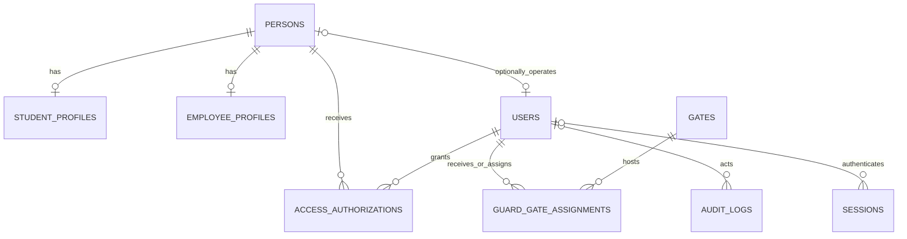
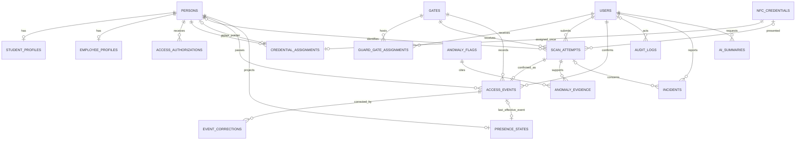

# NFCheck database and ERD proposal

Status: **Phase 7 monitoring, corrections and reporting implemented** in isolated Oracle MySQL 8.4.13. The larger ERD includes future modules. See [database setup](database-setup.md) and [the Phase 7 report](phase-7-report.md). Historical sections below describe their own checkpoints.

## Implemented Phase 7 additions

Phase 8 migration 17 additionally creates `anomaly_flags`, `anomaly_evidence` and `anomaly_reviews`; all four schemas now have 17 migrations. Immutable flags retain source/rule/version/configuration/anchor/evidence; status/reason/administrator history is append-only. The unique source/rule/version/anchor key prevents duplicate detection rows. Source/time and flag/review indexes support the review queue. Runtime grants are SELECT/INSERT only. Reviews serialize on the already lockable anchor-attempt row, then use current reads and a revision check. [Phase 8 evidence and limitations](phase-8-report.md).

Migration 16 adds `passage_corrections`: public UUID, event/actor foreign keys, note/void/reinstate action, reason and UTC microsecond creation time. It is append-only through model restrictions and SELECT/INSERT-only runtime grants. The latest void/reinstate action determines effectiveness; notes leave it unchanged. Stable person locking and expected correction revisions protect concurrent confirmation/correction. Original attempts and passages remain retained. All four recognized schemas now have 16 migrations.

Compound indexes on source/confirmation time, source/person/confirmation time and source/gate/confirmation time support passages; source/received time supports attempts. Reporting does not require duplicate analytics tables. Common queries implement Manila periods and source isolation. [Query evidence and metric definitions](phase-7-report.md).

## Implemented Phase 5 additions

Migrations 14/15 add `scan_attempts` and `access_events` and explicit non-null/reviewer checks; the ledger is now **15** in each fixed project schema. Unique `(guard_id,request_id)` and keyed payload fingerprints protect retry identity. Review expiry, auth/session binding, person revision and fresh server rechecks protect confirmation. Unique event-per-attempt and a composite event/attempt owner/gate/direction/source foreign key protect passage linkage.

Runtime attempts are SELECT/INSERT plus UPDATE only on named review-state fields, with no DELETE. Events and audit are SELECT/INSERT only. Eloquent additionally rejects historical mutations. Essential audit, review transition and event insert share a transaction. Stable person locks and current locking reads suppress same-person/gate/direction/source confirmations within the configured window across guards. At exactly 10 seconds, new passage is permitted. No presence projection, correction, anomaly or reporting tables were introduced.

Guard activity is bounded to 30 minutes/30 attempts at currently assigned active gates; administrator recent activity is limited to 50 attempts. Denied attempts do not disclose identity to guards. Review photographs require the same live authorized guard/gate/source/session context and disappear after review expiry/closure. Operation UUIDs are metadata locators, not credentials; raw references are never stored on attempts.

## Implemented Phase 4 additions

Migration 13 creates `nfc_credentials` and `credential_assignments`, and adds `persons.active_credential_assignment_id`. Credential states are pending/active/revoked/cancelled/expired. References are 32 random bytes encoded as versioned NDEF text; only unique BINARY(32) SHA-256 digests of the decoded secret are stored. Completion/session digests, issuer auth revision, 10-minute pending deadline and person revision bind completion to the issuing session and unchanged assignment.

Each credential has one permanent person assignment. Unique `(person_id,id)` plus a composite person/pointer foreign key prevents selecting someone else's assignment. New activation and normal replacement serialize on the person row and commit audit/selection/old revocation atomically. Lost revocation occurs in a separate committed operation before replacement. Closed references cannot be reused, reactivated or reassigned through the application. Expired references are denied by the clock before the optional cleanup command closes their rows. Inactive/archived people and missing effective access grants override otherwise active credentials.

Verification locks person, credential and assignment before reading current access authorization. The simulator uses the same verifier in a separate schema, with a server-fixed simulated source; normal inspection rejects simulated references. No attempt, passage, presence or reporting tables were added in Phase 4.

## Implemented Phase 2 subset

Ten migrations create `persons`, `users`, `student_profiles`, `employee_profiles`, `gates`, `access_authorizations`, `guard_gate_assignments`, `audit_logs`, `sessions` and `password_reset_tokens`, plus Laravel's migration ledger. They are applied to `nfcheck` and isolated `nfcheck_testing`; the web app has no migration credential.

- User emails are unique and normalized. Roles/statuses use enums; account security revisions revoke older sessions. A user may optionally link to one person. Administrator provisioning does not create an employee/person record.
- Person campus numbers are unique within their classification. Models reject ordinary person-type changes and profile/type mismatches; profiles use the person ID as their primary/foreign key.
- Foreign keys preserve identity/account/gate references. Audit rows have nullable actor/target references, allowlisted metadata and server timestamps; runtime SQL cannot update/delete them.
- Authorization/assignment validity uses inclusive starts and exclusive ends. MySQL CHECK constraints reject invalid intervals; scopes reject revoked/expired/future records, and inactive people override authorizations. Gate policies also require active guards/gates and the exact assignment.
- Session payloads are encrypted. Password reset hashes are separate from account passwords and expire after 30 minutes.

Phase 3 adds archived_at/record_version to persons, gates and users, plus archival indexes. Scheduled access/assignment intervals use DATETIME(6), stored in UTC. There are now 12 applied migrations in each schema. The main schema contains no development people/gates; QA fixtures were confined to testing and removed.

Management services preserve historical references, use edit versions/row locks, reject overlapping grants or same-guard/same-gate schedules, and audit mutations transactionally. DELETE endpoints archive; restoration leaves records inactive. Archiving people revokes grants; archiving gates/guards revokes assignments. Disabling guards also removes sessions and reset tokens. Credential/verification/passage/analytics tables remain deferred.

## Longer-term relational proposal

Use InnoDB-compatible transactions, foreign keys, `utf8mb4`, UTC timestamps with microsecond precision where supported, and explicit status/reason values. Internally use unsigned bigint primary keys unless a framework requirement justifies otherwise. Expose opaque operation identifiers rather than treating an obscure database ID as authorization. All identifiers still require object-level policies.

The diagram shows the planned core and later modules together. `presence_states`, anomaly tables, incidents, AI summaries and settings are conditional as detailed below. It omits framework infrastructure tables and some actor/authorization foreign keys for readability. A nullable relationship represents an unknown credential or absence of prior events, not permission to fabricate an identity.

## Identity and access tables

| Table | Proposed important columns | Constraints and indexes |
|---|---|---|
| `users` | `id`, normalized `email`, `name`, password hash, `role`, `status`, optional `person_id`, framework remember token, timestamps | Unique email; optional unique person link; role/status allowlists; no cascade deletion into history. |
| `persons` | `id`, `person_type`, `campus_number`, `full_name`, private `photo_path`, `status`, nullable `active_credential_assignment_id`, timestamps | Unique `(person_type, campus_number)`; unique active-assignment pointer; indexed type/status and searchable identity fields. |
| `student_profiles` | `person_id` primary key, `program`, optional `year_level`, optional `academic_term` | FK person; service validates student type and allowed values; no unnecessary personal attributes. |
| `employee_profiles` | `person_id` primary key, `department`, `position` | FK person; service validates employee type. |
| `access_authorizations` | `id`, `person_id`, `status`, `valid_from`, nullable `valid_until`, `reason`, `granted_by`, nullable revocation actor/time, timestamps | Person and user FKs; index `(person_id, status, valid_from, valid_until)`; valid end after start. |
| `gates` | `id`, unique `code`, `name`, `status`, timestamps | Unique code; indexed status. |
| `guard_gate_assignments` | `id`, `guard_id`, `gate_id`, `starts_at`, nullable `ends_at`, nullable revocation time/actor, timestamps | User/gate FKs; index `(guard_id, gate_id, starts_at, ends_at)`; end after start; role/overlap validity handled transactionally. |

One person initially has one student or employee profile according to `person_type`; dual affiliation is not assumed. Service-level transactions preserve cross-table profile/type consistency. Operator accounts are independent. Student/employee access status and operator account status have different meanings.

Effective authorization requires an active person and a currently valid non-revoked grant. Validity intervals are half-open: `start <= now < end`, with a null end meaning no scheduled end. Do not infer authorized access from record existence alone. The initial model uses campus-wide member grants; add gate-specific member scopes only when approved.

## Credential ownership and activation

| Table | Proposed important columns | Constraints and indexes |
|---|---|---|
| `nfc_credentials` | `id`, `token_digest BINARY(32)`, `status`, `created_by`, pending/read-back/activation/revocation/expiry timestamps as needed, nullable revocation reason, nullable `replaces_credential_id`, timestamps | Unique digest; self FK for replacement; indexed status/expiry; no raw token or secure-identity claim based on tag UID. |
| `credential_assignments` | `id`, `person_id`, `credential_id`, `assigned_by`, `assigned_at`, nullable `ended_at`, nullable end reason | Unique `credential_id`; unique `(person_id, id)` for owner-qualified pointer; person, credential and user FKs; index `(person_id, assigned_at)`. |

`persons.active_credential_assignment_id` is a nullable unique pointer. Add a composite foreign key `(persons.id, persons.active_credential_assignment_id)` referencing `credential_assignments(person_id, id)`. This guarantees that a non-null active pointer belongs to that person. The person row exists first, assignments are added next, and the pointer FK is added after both tables exist. A null pointer means no live credential. Use restricted deletion; a composite `SET NULL` would also affect the non-null person ID and is inappropriate.

The pointer enforces one selected active assignment per person; it does **not** independently enforce credential state or expiry. All issuance, activation, revocation and verification use the same transactional service. Lock the stable person row, verify ownership and state, activate the selected credential, revoke/end any replaced assignment, update the pointer, and audit atomically. Verification requires an active credential, matching permanent owner assignment, matching active pointer, valid expiry and valid member authorization.

Credentials move from pending to active only after the read-back workflow. Cancelled/failed/expired pending issuance is unusable. Lost-credential revocation clears the pointer and ends the assignment immediately, even if replacement subsequently fails. A revoked credential remains in history and cannot be reactivated or reassigned. Replacement always creates new random material. Assignment ownership is immutable; termination fields record its history.

## Attempts, confirmed passage and correction history

| Table | Proposed important columns | Constraints and indexes |
|---|---|---|
| `scan_attempts` | `id`, opaque operation ID, `guard_id`, `gate_id`, applicable assignment ID, `request_id`, canonical payload fingerprint, `direction`, nullable `person_id`, nullable `credential_id`, nullable `authorization_id`, immutable verification `outcome`/reason/policy version, `received_at`, `review_expires_at`, controlled `review_status`, nullable `reviewed_by`, `reviewed_at`, bounded review reason, `source` | Unique operation ID and `(guard_id, request_id)`; FKs; indexes `(received_at, id)`, `(gate_id, received_at)`, `(person_id, received_at)`, `(outcome, received_at)`, `(review_status, review_expires_at)`. |
| `access_events` | `id`, `scan_attempt_id`, `person_id`, `credential_assignment_id`, `gate_id`, `guard_id`, `direction`, decision/policy snapshot, `confirmed_at`, `source` | Unique attempt FK; all historical FKs restricted; indexes `(confirmed_at, id)`, `(person_id, confirmed_at)`, `(gate_id, confirmed_at)`, `(direction, confirmed_at)`. |
| `event_corrections` | `id`, `access_event_id`, `action` (`annotate`/`void`), reason, `actor_id`, `created_at` | Event/user FKs; append-only; index `(access_event_id, created_at)`. |

Unknown credentials produce attempts with nullable person/credential references and controlled reason codes. Do not store raw credential input, unrestricted device metadata or personal data in arbitrary JSON. Bound all request fields. If repeated unknown-token correlation is needed for a rule, use a protected fingerprint with a documented retention purpose, not plaintext input.

The review TTL starts at server receipt; the initial proposal is 30 seconds and must be tested at gates. Exact request retries return the same attempt without extending that TTL. Reusing a request key with a different canonical payload is rejected. Confirmation always performs fresh authorization checks, including when returning an already-recorded outcome to an otherwise permitted operator.

For different request IDs, confirmation also checks effective recent passage for the same person/gate/direction under the person lock. Within the configurable duplicate window, write no second event: terminate the new review as `cancelled`, reason `duplicate_passage`, and return an authorized reference to the existing event. Store optional `duplicate_of_event_id` on the attempt, with its FK added after `access_events` exists. Preserve the second verification facts and audit. Select the threshold in Phase 5; test concurrent guards, boundary conditions and intentional later passage. An index supporting person/gate/direction/time should be evaluated for this query.

Allowed verification is not passage. Only an explicit valid guard confirmation inserts an event. Unique attempt linkage prevents double insertion. Lock the person and any persisted presence row in a consistent order, enforce the fresh checks, and commit the event, essential audit data and projection together. Duplicate-tap policy and sequence warnings are separate from transport retry idempotency.

Keep verification facts immutable. Allowed scans start review `pending`; denied scans use `not_applicable`. Only an audited compare-and-set terminal transition from pending to `confirmed`, `identity_mismatch`, `cancelled`, or `expired` is permitted. Store reviewer/time/reason, with server time authoritative for expiry even before an expired state is materialized. Confirm and event insertion commit together; cancellation/rejection must win or lose atomically against confirmation and cannot be undone into success. Take locks in the common person/attempt order and test the race. Exact transport retries do not reopen review. Ordinary users cannot otherwise edit/delete history. A correction preserves original rows and uses an audited effective-event projection. Voiding an event requires recalculating affected presence, report aggregates and related anomaly review context. Query reports from effective confirmed events; count denied scans from attempts, never as passages.

## Conditional tables

| Table / phase | Purpose and proposed constraints |
|---|---|
| `presence_states` / 5 or 7, only if persisted projection is needed | `person_id` primary/FK, state `unknown`/`inside`/`outside`, nullable last effective event FK, update time/version. Lock with person. Start unknown; an Exit from unknown records outside and flags missing context without automatic denial. Derive/rebuild from effective events. |
| `anomaly_flags` / 8 | Rule identifier/version, unique deduplication key, type, severity, explanation, evaluation window, state, reviewer/time/resolution. Index state/severity/time. No guilt or disciplinary conclusion. |
| `anomaly_evidence` / 8 | Composite primary key `(anomaly_flag_id, scan_attempt_id)` with FKs. Evidence can relate to confirmed events through their attempt. |
| `incidents` / guard reporting scope | Reporter and gate FKs, optional attempt FK, bounded description, status, reviewer and resolution/time. Access-controlled text; preserve review history if multiple updates need traceability. |
| `ai_summaries` / 9, conditional approval | Reporting interval, validated aggregate snapshot/hash, prompt/provider/model versions, generation/review status, output text, requester/reviewer FKs, generated time and bounded error code. No raw identities, credentials or API keys. |
| `system_settings` / only where required | Unique allowlisted key, validated value/type, updater and time. Audit changes; exclude secrets and arbitrary executable configuration. |
| `import_batches` / deferred | Create only with an approved import module and its validation, rollback/error and provenance requirements. |

`audit_logs` is a core foundation, not conditional: actor FK may be null for system events; store action, target type/ID, outcome, server time, and redacted bounded changes. Index actor/time, action/time and target. Its polymorphic target is a controlled audit reference rather than a relational authorization shortcut. Keep essential mutation audits in the same transaction. Do not claim application append-only controls prevent database administrator tampering.

## Implementation and verification constraints

- Use migrations in dependency order: users/people/gates, grants and assignments, credentials and owner assignments, active-pointer FK, attempts/events, then extensions. Framework session/reset/job/cache tables are selected according to runtime configuration.
- Use database `CHECK` constraints where supported and tested; Laravel validation alone does not replace foreign keys or uniqueness. Cross-row state and validity require transactional services and concurrency tests.
- Prefer deactivation and restricted deletion. Retention/anonymization migrations require an approved institutional policy, legal hold handling and a backup-aware disposal plan.
- Convert Asia/Manila reporting periods into half-open UTC ranges. Test midnight and month/year boundaries. Keep scan receipt and confirmed passage timestamps distinct.
- Verify duplicate keys, credential-owner mismatch, interrupted replacement, immediate lost-token revocation, expiration during review, concurrent confirmation/replacement and projection rebuilds using the actual selected database engine.
- Test query plans with representative authorized fixtures before adding indexes beyond known filters. No operational rows or counts are hardcoded in React. Development/test fixtures remain explicitly separate from institutional data.
