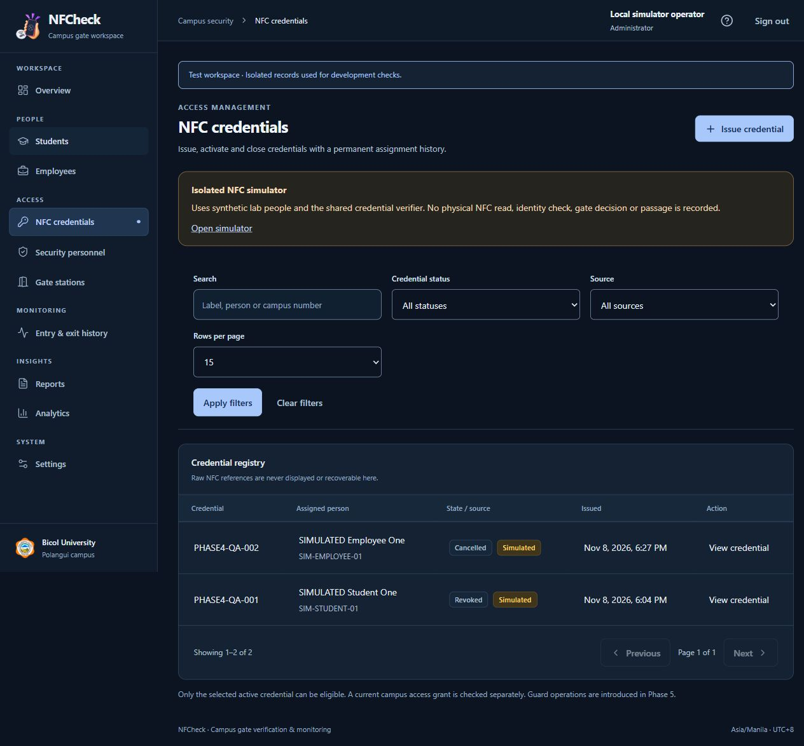
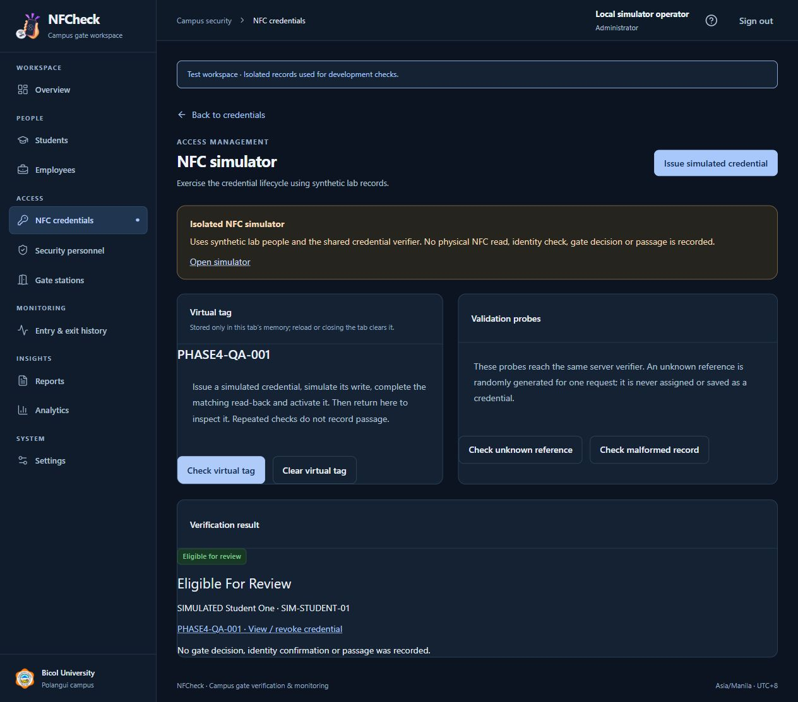
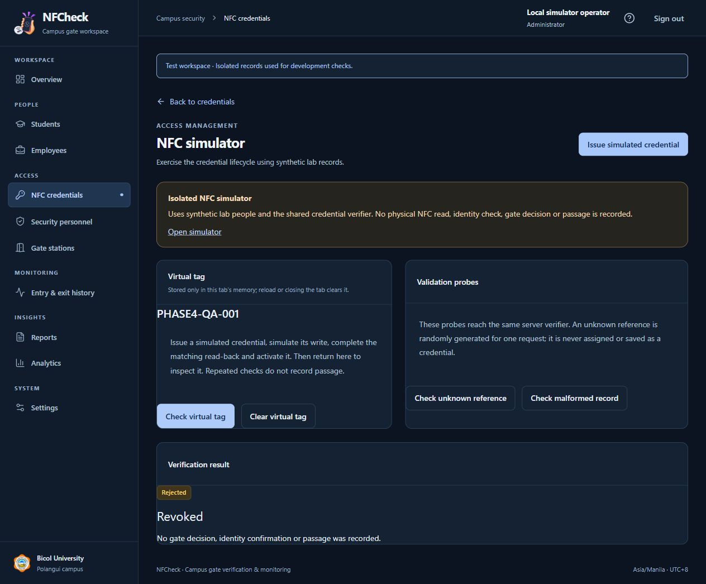

# Phase 4 — NFC credential management

Status: **Complete for the approved software scope. Stop before Phase 5.** Verified November 8, 2026. Physical NFC behavior is explicitly untested and remains a Phase 6 acceptance item.

## Delivered

- Administrator credential registry with search, source/status filters, pagination, details and person-history links.
- CSPRNG generation of 32-byte secrets; canonical versioned NDEF text and unique binary SHA-256 digest lookup. No personal information on a tag and no UID trust.
- Permanent assignment, pending issuance, separate matching read-back and activation. Ten-minute completion window; same actor/auth revision/session/nonce/reference and unchanged person revision are required. Idempotent activation retry does not duplicate history.
- Cancellation, revocation reasons, independent lost-tag revocation, and atomic normal replacement. Closed credentials remain closed; archive closes pending/active credentials. Validity and grants are checked against server time.
- Browser NDEF adapter with strict single-text-record parsing, canonical validation, bounded decoding, user-triggered write/read operations, aborts, 30-second operation bounds and unsupported-device messaging.
- Dedicated local simulator with its own schema, key, operator, synthetic people and source. Its virtual tag exists only in tab memory. Real and simulated inputs share `CredentialVerifier`; normal inspection rejects simulated references.

Phase 4 inspections report eligibility for review only. They create redacted audit records, **no gate decisions, verification-attempt records, passage events or presence changes**. Operational duplicate-scan suppression and guard confirmation belong to Phase 5.

## Main files and database changes

Backend: `app/Services/Credentials/*`, `app/Models/{NfcCredential,CredentialAssignment}.php`, credential controller/request/policy, simulator middleware, expiry command and migration `000013_create_credential_lifecycle`. Person archive and detail flows now include credentials. Routes, throttles and Inertia metadata were extended.

Frontend: `resources/js/pages/credentials/*`, credential components, `lib/{credentials,nfc}.ts`, person history, shared layout and styles. Provisioning/startup: `scripts/{bootstrap-simulator,seed-simulator,serve-simulator}.php`, `start-simulator.ps1` and the scoped migration helper.

All three fixed project schemas have **13 applied migrations**. Unique digest/request/label constraints, credential-to-assignment uniqueness, retained foreign keys, an owner-qualified active pointer and interval checks protect relationships. Application services serialize mutations under actor/person locks and atomically audit them. Runtime accounts have no DDL; audit grants are SELECT/INSERT only. Existing main people, gate, operator and three requested administrator accounts were preserved. No synthetic Phase 4 records were inserted into the main schema.

## Validation

| Check | Result |
| --- | --- |
| Full backend suite | **109 passed, 1,193 assertions** |
| Credential lifecycle coverage | **22 tests**, included in the full suite |
| Node NDEF adapter tests | **6 passed** |
| TypeScript and Vite production build | Passed |
| Pint and Prettier | Passed |
| Composer validation/audit and npm audit | Passed; no reported advisories |
| Schema/runtime inspection | 13 migrations each; no runtime DDL; append-only audit grants; no operational event tables |
| Test fixture isolation | Testing users/people/gates/credentials/assignments returned to zero after transactions |

Backend coverage includes canonical/malformed/unknown references, pending and active expiry boundaries, cancellation/reissue, duplicate pending/label/request prevention, stale person changes, actor/session/nonce/payload/source binding, required read-back, idempotent activation, current selection/access/inactive checks, permanent ownership, replacement, audit-failure rollback, independent lost revocation, archive/restore, source isolation, guard denial, no-store receipt delivery and secret-free page props/session handling. Tests verify the exact isolated testing connection before transactions; no schema reset command was used. This is not a concurrent load or RF reliability assessment.

Browser QA in the isolated simulator completed prepare → virtual write → matching read-back → activate → eligible, repeat inspection, report lost → revoked rejection, and unknown/malformed rejection. No raw reference or nonce was displayed. The completed QA credential remains revoked in lab history; a second pending issuance was reloaded, proved unrecoverable and cancelled; the main credential registry remained unaffected. Responsive inspection covers 360, 768 and 1280 pixel widths without document overflow. A wrapped-label tap issue was fixed and verified on the mobile registry. Screenshots contain synthetic data only.

## Security and limitations

Raw issuance data is returned once through authenticated, throttled, no-store JSON. It never enters Inertia props/history, URLs, sessions, logs or persistent browser storage; only digests are persisted. Credential writes require JSON acceptance so validation cannot flash form data into a session. Secrets clear on leaving/hiding issuance; a lost response requires registry review and fresh issuance, with no automatic secret redelivery. The virtual tag retains only the simulated payload in memory until explicit clear, page hide, reload or sign-out.

Simulator routes require loopback, explicit flag, local/testing environment and a simulation/testing schema. Production rejects even a configured flag. Use **localhost:8002** for the simulator and **127.0.0.1:8000** for the main app to separate browser cookies. The common XSRF cookie can conflict when both ports are opened on the same host; reloading refreshes it and clears any pending receipt.

NDEF is a copyable bearer reference. Matching read-back is software workflow evidence, not RF attestation, identity proof or anti-cloning. API detection does not prove hardware support. Android Chrome permissions, tag formatting/locking, physical writes/read-backs, device visibility behavior and real network/RF interruption need hardware acceptance. The prepared adapter uses documented Web NFC APIs; it has only been exercised with mocks and simulation. See [manual hardware instructions](nfc-integration.md).

The isolated toolchain and shared-XAMPP/source-denial boundary remain intact. No public deployment occurred. Local runtime/seed credentials remain in ignored, Windows-access-restricted files; they are not included in this report or repository.

## Checkpoint

Phase 4 is ready for review. Next is **Phase 5 — guard gate entry/exit verification**, including gate assignments, review/confirmation, operational duplicate handling, immutable attempts/passages and activity display. It requires explicit approval; no Phase 5 implementation is included here.
