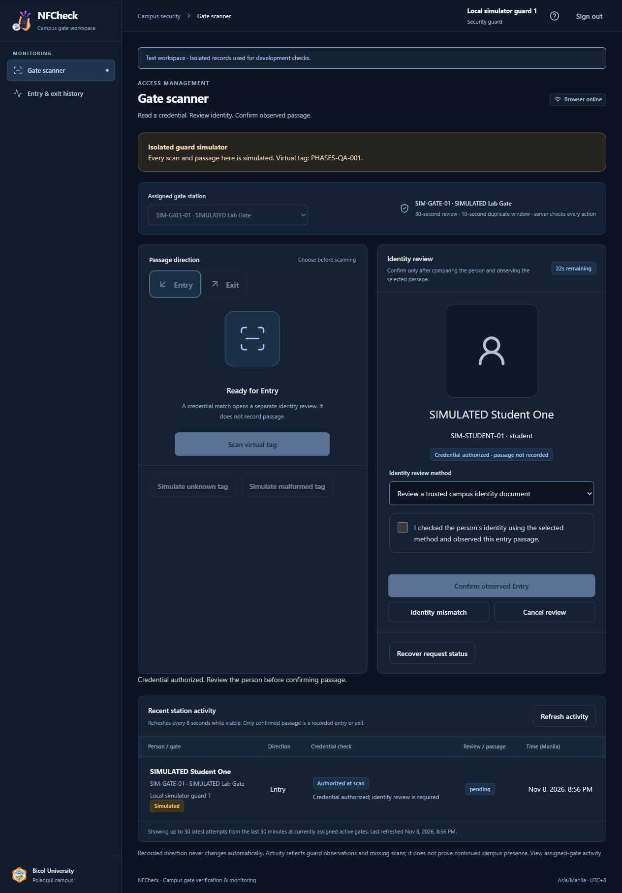
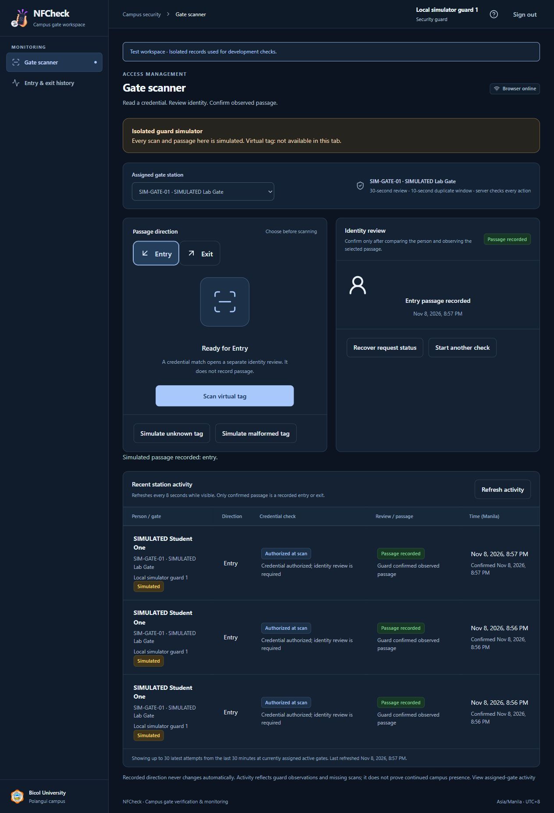
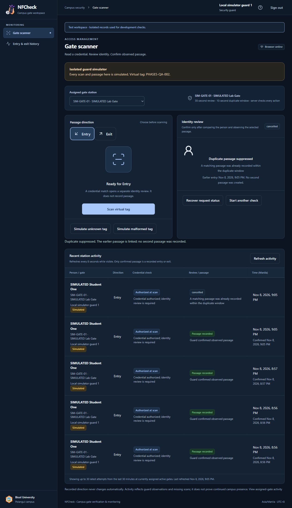

# Phase 5 — Gate verification and confirmed passage

Status: **Complete for the approved software scope. Stop before Phase 6.** Verified November 8, 2026. The user selected **30-second review validity** and a **10-second duplicate-passage window** as configurable development defaults. Physical NFC readiness remains unverified.

## Delivered behavior

An active guard chooses a currently assigned active gate and explicitly selects Entry or Exit. A scan invokes the shared credential verifier and stores a verification attempt. An authorized credential opens a separate identity review; it does **not** record passage. Confirmation requires the guard's explicit identity/observed-passage checkbox and review method. A current private photograph is available only for that guard's live permitted review; a trusted campus identity document is the explicit development fallback when a photo is unavailable.

The server rechecks the guard/auth revision, session binding, gate, effective assignment, credential/source, permanent owner/current selection, active person, identity-record revision, validity and current access grant. Changed authorization closes the stale review without passage. Identity mismatch, cancellation and expiry are terminal. Only a successful explicit confirmation creates an immutable passage event. Direction is never inferred or alternated automatically.

Each `(guard_id, request_id)` is unique and bound to a keyed fingerprint of the exact gate/direction/source/reference. Exact retries return the original attempt and deadline. Changed input cannot reuse the ID. The UI can recover an uncertain result before retrying; a permitted reload recovers by the non-secret request UUID in the URL, without retaining the reference. Operation lookup is bound to the same guard, gate, source, auth revision and session.

Confirmation serializes on the person row. Different requests/guards for that person/gate/direction/source within the selected window produce one passage and a cancelled duplicate review linking the earlier event. Exactly 10 seconds after the earlier event, a new passage is permitted. Microsecond boundary tests cover that rule. A repeated direction outside the window or an Exit without an earlier recorded Entry produces a contextual note, without automatic denial or a claim of wrongdoing. No persisted presence estimate was added.

Recent activity refreshes every 8 seconds while visible. Guards see at most 30 attempts from the last 30 minutes at currently assigned active gates, with no identity disclosure for denied attempts. Administrators see up to 50 latest attempts. Authorized-at-scan, review state and confirmed passage are separate columns. Full historical reporting, exports, dashboard aggregates and anomaly/AI modules remain deferred.

## Database, source and files

Migrations **14/15** create and harden `scan_attempts` and `access_events` in the three fixed isolated schemas. They add unique request/attempt keys, restricted historical foreign keys, explicit non-null deadline/duplicate-reason and same-guard reviewer checks and a composite event-to-attempt identity foreign key. Runtime SQL can insert/read passage events but cannot update/delete them. Attempts permit updates only to named review-state columns; verification facts cannot be rewritten or deleted by the runtime account. Essential audits and review/event writes commit atomically.

Backend files include `app/Services/GateOperations/GateOperations.php`, the shared `CredentialVerifier`/`CredentialCheck`, operation/activity controllers, JSON-only request validation, two history models, review-expiry command, migration and scoped privilege helper. Frontend files are `pages/operations/*`, `components/operations/*`, `lib/operations.ts`, the memory-only tag handoff and layout/readiness updates. `scripts/test-gate-concurrency.php` supplies repeatable concurrent-process checks.

The simulator is still restricted to local/testing environment, loopback, explicit flag and simulation/testing schema. Both transports use the same verifier and passage service. Routes fix the source server-side; simulated references cannot create physical passages. Normal administration never impersonates a guard: lab handoff signs out and requires a real sign-in to a separate synthetic guard account. The unreceived virtual tag expires after two minutes; once accepted by a server-authorized lab guard check, it remains only in tab memory until reload/page hide, ordinary sign-out or clearing. No reference enters URLs, Inertia props/history, sessions, files, logs or browser storage.

## Verification results

| Check | Result |
| --- | --- |
| Full PHP suite | **132 passed, 1,324 assertions** |
| Gate-operation coverage within suite | **23 tests, 131 assertions** |
| NDEF / virtual-tag adapter tests | **8 passed** |
| Real concurrent PHP/MySQL scenarios | **4 passed**, overlapping blocked transactions observed |
| TypeScript / Vite production build | Passed |
| Pint / Prettier | Passed |
| Composer validation/audit and npm audit | Passed; no reported advisories |

Coverage includes scan-versus-passage separation, same-key retries/conflicts, required identity review, unknown/malformed/revoked/inactive references, fresh grant/assignment/credential/record checks, replacement during review, expiry and microsecond boundaries, terminal cancel/mismatch, current private-photo access/expiry, wrong actor/session/source, essential-audit rollback, immutable runtime/model constraints, simulated-source exclusion and restricted activity.

Concurrent workers prove: (1) two guards/different requests yield one passage plus one duplicate; (2) same-request retries yield one attempt/event; (3) confirm/cancel yields one consistent terminal result; (4) confirm/revoke cannot record passage after committed revocation. The CLI harness verifies the exact testing instance, passes references through anonymous stdin only, and cleans only captured fixture IDs using a private maintenance connection. Testing row counts return to their pre-run values. No schema reset is used, and no synthetic operation is written to the main schema. These bounded race checks are not a peak-load benchmark.

Browser QA used synthetic people and the lab guard account: administrator issuance and handoff, assigned-gate selection, explicit Entry and Exit, quick duplicate suppression, unknown rejection, identity mismatch, cancellation, 30-second expiry and pending-review reload recovery. Recovered reviews retain their original server deadline. Layout checks at **360, 768 and 1280 pixels** showed no document overflow. Lab history is retained and labeled simulated; QA credentials are closed afterward.

## Limits and next checkpoint

Phone/tag RF behavior, native permission prompts, real write/read-back reliability and trusted mobile HTTPS remain Phase 6 acceptance work. Simulation does not prove physical identity, anti-cloning or actual crossing. Campus security must accept the timing, duplicate policy, identity-document fallback and recent-activity window before operational use. The system does not control emergency exits or barriers.

Review expiry is enforced on every operation, regardless of cleanup. `nfcheck:expire-reviews` materializes otherwise unattended expiry; no scheduler daemon was installed. History has no ordinary edit/delete API; corrections and broad reporting remain later work. No real presence count, anomaly finding or AI output is fabricated.

Final runtime inspection found 15 migrations per schema, zero testing fixtures, zero main attempts/passages, and 11 lab attempts / 5 simulated passages with no pending reviews. Five forbidden immutable-table SQL operations were rejected in each runtime schema; all three requested main administrators remain active. Existing main accounts, people, gates, credentials and user passwords were preserved. Shared XAMPP and the source-denying Apache boundary remain unchanged. No public deployment occurred.

Next: **Phase 6 — physical NFC integration and acceptance**, only after explicit approval. No physical tests are claimed complete by this checkpoint.

Implementation references: [Laravel pessimistic locking](https://laravel.com/framework/docs/13.x/queries#pessimistic-locking), [MySQL locking reads](https://dev.mysql.com/doc/refman/8.4/en/innodb-locking-reads.html). Transaction/lock choices were checked against these official references and exercised against the pinned MySQL runtime.
